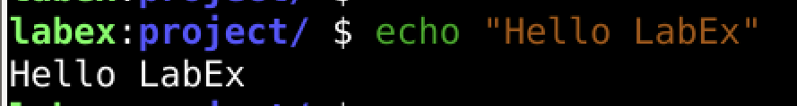
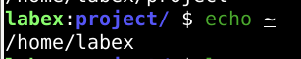
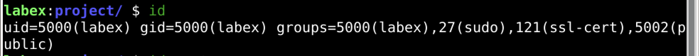
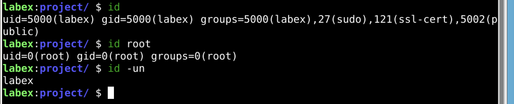
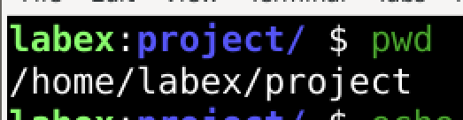
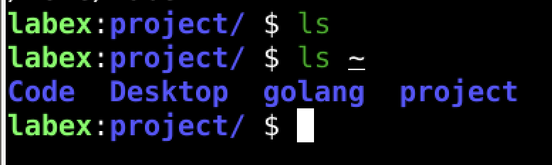
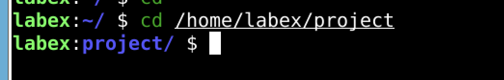

echo - вывод

whoami - показываем с какого юзера я сижу

id - показывает инфу о номер id , первинчую группу и список групп к которым я принадлежу

pwd - print working directory

ls (list) - показать содержимое директории

cd - change directory
Абсолютный путь начинается с / и содержит весь путь

